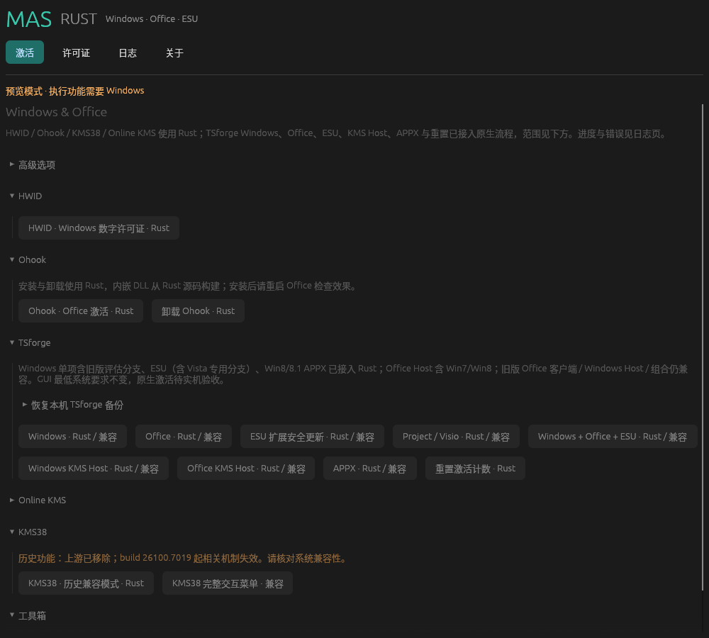
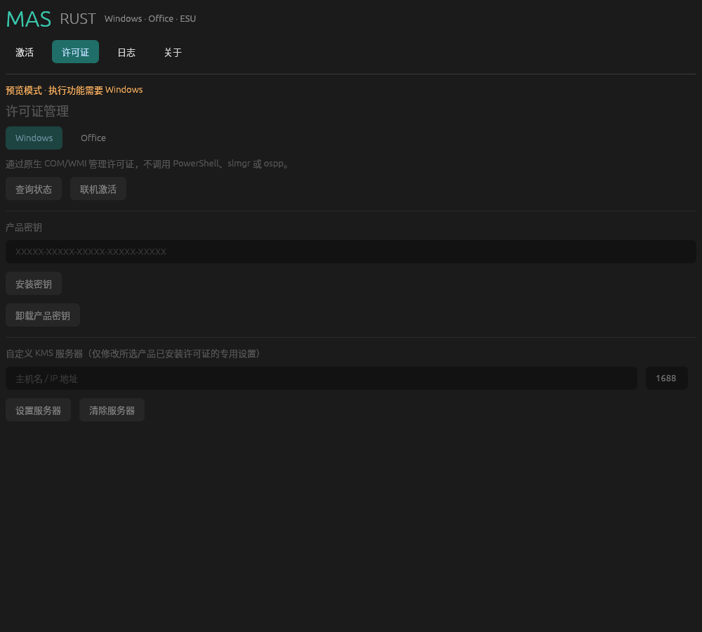

<p align="center">
  
</p>

# MAS Rust

使用 **Rust + egui** 构建的 Windows / Office 激活与许可证管理桌面前端，内嵌固定版本的 [Microsoft Activation Scripts（MAS）](https://github.com/massgravel/Microsoft-Activation-Scripts)，提供中文界面和独立应用图标。

[](https://github.com/undownding/MAS-rust/actions/workflows/build.yml)
[](LICENSE)

[功能](#功能) · [界面预览](#界面预览) · [获取与使用](#获取与使用) · [构建与运行](#构建与运行) · [验证范围](#验证范围)

**v0.6.0-dev.15：接入 Win7/Win8 Office KMS Host 原生分支；旧版 Office 客户端、Windows Host 和组合仍兼容。GUI 最低 Windows 版本不变，旧版后端仍待实机验收。**
原生路径直接调用 COM/WMI、Windows 服务与许可 API，不启动 PowerShell；票据签名由 Rust 实现，导入使用 Windows 自带的 `clipup.exe`。

TSforge Windows / Office / Project / Visio / ESU / KMS Host / APPX 单项入口已连接原生 SKU/订阅识别、产品选择、生成密钥安装、激活与结果校验；Windows 单项含评估版、ESU（含 Vista/Server 2008 专用分支）和 Win8 APPX 已连接旧版存储后端；旧版 Office 客户端、Windows Host 和组合仍转入兼容引擎，原生失败后不会自动再运行兼容激活。重置与备份恢复也使用 Rust。旧存储及部分修复/高级工具仍使用固定版本的上游脚本。**这还不是完整的纯 Rust MAS**，实现范围与剩余工作见 [核心分析与迁移记录](docs/native-migration.md)。


## 界面预览



截图来自 Linux 下的实际运行画面。Linux 为预览模式，因此执行按钮置灰；激活和许可证操作需要在 Windows 上运行。图中 TSforge 已展开，Windows、Office、Project/Visio、ESU、两种 KMS Host、APPX 和组合按钮标注 Rust / 兼容，重置按钮标注 Rust；Online KMS 和高级选项处于折叠状态。内容区随窗口宽度展开，滚动条固定在右侧。



### 恢复 TSforge 备份

在“激活 → TSforge → 恢复本机 TSforge 备份”中粘贴日志里的备份目录（包含 `manifest.json`），点击“恢复备份 · Rust”并核对确认信息。只使用本机生成的备份。

重置按阶段生成备份；若要恢复到本轮重置前的物理存储，应选择本轮**第一个阶段**的备份，而不是最后一个。恢复会校验目标路径、SHA-256、加密完整性及存储格式，先保存当前文件，再写入所选备份。现代/Win8 重置阶段备份恢复 `data.dat`；Vista/Win7 重置备份分别恢复主副文件原始字节及副本原始存在状态，原本不存在的副本会在恢复时移除。旧版副本不作为主文件损坏时的备用来源。带联合状态标记的备份会同时恢复物理存储（包括旧版主副文件）、`tokens.dat` 和清单中的产品注册表值，并清理派生许可缓存。注册表目标由程序固定映射，清单不能指定任意路径。恢复可能覆盖备份后发生的许可变化。PKEY2005 安装会记录卸载前检查点及联合备份；PKEY2009 的 SLC 卸载/安装不具备自动回滚，后续激活失败也可能已改变密钥。KMS 配置清理不在这些存储备份的覆盖范围内。原生激活、重置和恢复仍待 Windows 实机验收。

## 功能

| 功能 | 入口 |
| --- | --- |
| HWID | 原生 Rust 主流程，支持禁止自动更改版本 |
| Ohook / 卸载 | Rust 许可准备、DLL 构建/部署、用户配置和卸载恢复 |
| TSforge Windows 单项 | Rust：普通版含 Vista/Win7/Win8 存储后端；SCID 仅 Win8+；评估版按目录匹配并独立联网激活 |
| TSforge ESU 单项 | Rust：含 Vista 固定密钥分支；按本机 ESU 许可证和版本/UBR 筛选，SCID 仅 Win8+，其余使用 ZCID |
| TSforge Windows KMS Host | Rust：build 9600+；旧版兼容；CSVLK 许可准备、SCID/ZCID 和主机计数处理 |
| TSforge Office KMS Host | Rust：含 Win7/Win8 存储；按固定目录选择本机已有 2010–2024 主机许可，SCID 仅 Win8+，支持 ZCID |
| TSforge APPX 旁加载许可 | Rust：Windows 8/8.1 原生存储；其他版本直接跳过 |
| TSforge Office / Project / Visio | Rust：build 9600+，C2R/MSI/UWP 许可准备与 SCID/ZCID/KMS4k；旧存储兼容 |
| TSforge Windows+ESU+Office | Rust：现代存储，共享方法与清理，逐范围汇总；评估版独立联网激活，旧存储兼容 |
| TSforge 重置 / 备份恢复 | Rust：版本化标记、rearm/计时器、密钥锁；现代/Win8 单文件、Vista/Win7 双文件事务；旧版后端待实机验收 |
| Online KMS Windows / Office / Project / Visio / 卸载 | Rust 主流程；Office 支持 C2R 转换及 MSI 批量许可；支持自定义主机、端口与原生续期 |
| KMS38 | 原生 Rust 主流程；历史菜单仍为兼容引擎 |
| 激活状态、Windows / Office 版本切换、排障、OEM 提取、其他高级选项 | 工具箱 → 完整 MAS 菜单 |
| 密钥安装 / 卸载、联机激活、自定义 KMS 主机与端口 | 许可证页，Rust 直接调用 COM/WMI |

上游 MAS 当前版本已移除 KMS38。这里保留移除前的固定版本；上游注明 **build 26100.7019 起 CLiP KMS 许可机制被废弃**。历史引擎不能恢复新系统已删除的能力，不能承诺所有 Windows 版本均可使用 KMS38。
参考：[移除提交](https://github.com/massgravel/Microsoft-Activation-Scripts/commit/470d3b900e6aebfba224fde3ea7957308dd61230)。

## 获取与使用

### 获取 Windows 程序

前往 [GitHub Actions](https://github.com/undownding/MAS-rust/actions/workflows/build.yml)，选择成功的 `Windows build` 运行，在 Artifacts 中下载 `mas-rust-windows-x64`，解压后运行 `mas-rust.exe`。下载 Actions 构建产物通常需要登录 GitHub；也可以按下方说明自行编译。

2026-10-24，用户反馈 v0.2.0 测试工作正常。尚未记录具体 Windows 构建号和所测功能组合，这一反馈不代表全部激活方式及 Office 版本均已验证。

### 操作步骤

1. 运行 EXE 并接受 Windows 管理员提示。
2. 在“激活”选择方法和参数，确认后在日志页查看执行进度与错误。
3. 工具箱中的完整菜单包含上游的版本切换、排障和 OEM 等交互流程。
4. 非交互任务完成后到“许可证”查询状态；完整交互菜单仍在独立窗口运行。
5. “日志”页可复制进度与任务结果。兼容引擎非交互日志保存在 `%LOCALAPPDATA%\MAS-Rust\logs`；交互菜单输出在独立窗口显示。

### TSforge Windows 原生流程

Windows 单项的“默认”在 build 26100+ 使用 KMS4k，较旧版本使用 ZeroCID；可在高级选项明确选择 StaticCID（需要联网）、ZeroCID 或 KMS4k。组合激活入口仍使用兼容引擎的对应规则。

原生入口先读取版本、订阅基础 SKU 和许可配置，再准备密钥；KMS4k 在安装前清理固定的 KMS 配置与相关 IFEO 项，删除后回读验证，不自动恢复这些配置。PKEY2005 安装保存存储/产品注册表备份；PKEY2009 直接调用 SLC。日志区分准备、安装和后续激活失败，并保留已生成的备份路径。已有永久许可通常跳过；按固定上游规则，build 26100 且 UBR < 4188 例外。原生流程成功指其状态或宽限期校验通过，不代表已完成所有 Windows 构建的实机测试。

ESU 单项的“默认”在 build 26100+ 选择 StaticCID，较旧版本选择 ZeroCID；ESU 不支持 KMS4k。预检查未确认联网时，显式 StaticCID 和需要联网的 ESU Auto 会在密钥安装前停止。预检查使用上游对应的 DNS 解析与 Windows Network List Manager，不保证激活服务实际可达。

ESU 仅处理本机已有、适用于当前版本的许可证，家庭版等新增支持版本还有 build 19045 的修订号门槛。逐项记录成功与失败；全部成功时，对适用产品调用系统自带的 ClipESUConsumer/ClipESU 后处理。许可状态不代表所有年份都能通过 Windows Update 获取更新。Windows/ESU 激活执行后会清理两个固定 SPP 持久状态值并提交任务重评估；这些值不在许可存储备份范围内，重评估失败会单独报告。

Windows 单项的旧版普通系统分支按本机许可证选择密钥：Vista 使用固定目录，Win7 KMS4k 使用固定 GVLK，Win7 ZeroCID 和 Win8 使用生成密钥；StaticCID 仅适用于 Win8 及以上。固定密钥安装核对 ID、通道和末五位；生成 PKEY2005 保留卸载前联合备份。安装后的激活失败不自动撤销 SLC/WMI 操作，也不重跑脚本。此接入不表示当前 GUI 能在 Vista/7/8 上运行；旧版实机兼容性与完整激活结果尚未验收。

### Windows 评估版

Windows 单项（含旧版存储）和 build 9600+ 的组合入口会识别评估版，匹配本机评估许可证及固定上游密钥目录，检查联网后执行带备份的计时器重置、安装评估密钥并请求 Windows 联网激活。评估分支独立于 SCID/ZCID/KMS4k 方法，不使用这些方法代替联网激活。

安装后核对目标许可与密钥末五位，激活后要求许可状态为已许可且剩余期限向上取整为 90 或 180 天。重置成功不代表激活成功；任何阶段失败都报告已完成阶段和备份信息，不自动回滚或改用脚本。评估版不会因此变成永久许可，部分旧版本存在上游已知激活问题；不在目录或本机没有对应许可证时不执行重置。旧版组合入口仍兼容。

### Windows KMS Host 原生流程

此入口安装 **KMS 主机许可证**，与 KMS 客户端不同。确认窗口会说明：Software Protection 服务将持续运行，部分 Windows 版本可能随后显示不同的版本名称。build 10586+ 先导入当前版本目录中的 CSVLK 许可，再选择覆盖产品最多的适用主机 SKU；密钥准备必须通过 Volume:CSVLK 通道校验。许可导入失败会报告已完成数量，不自动撤销。

默认方法在 build 26100+ 使用 StaticCID，较旧版本使用 ZeroCID；明确拒绝 KMS4k，联网检查在许可导入前完成。激活状态验证通过后，写入上游对应的 25 个客户端计数并刷新许可，再提交 SPP 任务重评估。旧版存储仍使用兼容引擎；Office KMS Host 走独立的已有许可证筛选流程。此流程尚无真实系统的主机激活验收。

### Office KMS Host 与 APPX

Office KMS Host 原生入口从两个 Office 应用 ID 中筛选已安装的 2010、2013、2016、2019、2021、2024 主机许可证；没有许可证会提示先安装对应许可证包，不下载或猜测产品。逐项安装生成密钥、激活并验证 CSVLK 主机计数，部分失败保留各产品结果。它不用于激活本机 Office 客户端应用，不支持 KMS4k。

APPX 入口只处理上游 Windows 8/8.1 的 4 类旁加载许可证，其他系统直接跳过；Windows 8 的旧存储已接入原生路径。原生存储后端不等于此 GUI 已支持所有旧系统，GUI 的运行要求仍见构建说明。两种入口均通过联网判断、原生结果校验与 SPP 重评估；均未完成真实系统激活验收。

### Windows + ESU + Office 组合流程

组合入口在开始修改前统一检查系统与方法：Auto 在 build 26100+ 选择 StaticCID，较旧版本选择 ZeroCID；自动模式未确认联网时改用 KMS4k。KMS4k 明确跳过 ESU，继续 Windows 与 Office。共享 KMS 配置清理只执行一次，完成三个范围后统一提交 SPP 重评估。

Windows、ESU、Office 分别记录结果，某一范围失败仍继续其他范围；汇总结果保留所有失败和跳过原因。已永久激活的 Windows 跳过密钥安装；不适用的 ESU 说明原因。旧存储在任何原生修改前转兼容；执行中出现错误或新的兼容请求，不会自动重跑脚本。

### TSforge Office / Project / Visio

build 9600+ 使用原生流程：识别 C2R/MSI/UWP，选择匹配产品，导入本机缺失的许可证，再安装密钥、激活并验证结果。UWP 通过 Windows 包 API 查询，不启动 PowerShell。Auto 在 build 26100+ 使用 StaticCID，较旧版本使用 ZeroCID；StaticCID 自动模式未确认联网时改用 KMS4k。

O365 和 ARM 产品可能转换为 Mondo；KMS4k 将支持的 C2R Retail 转换为 Volume，跳过不支持的 MSI Retail。免费 Retail 产品安装后须验证已许可，不能直接执行 KMS4k。Project / Visio 模式只选对应产品，并保留其他产品家族的密钥。

流程会清理订阅许可缓存；可能需要重新登录 Office。没有 MSI 且准备成功时卸载冲突密钥；Insider 系统按需重新导入本机系统许可。配置、缓存、许可导入和密钥卸载不自动撤销；部分失败保留各项结果，原生错误不会自动重跑兼容脚本。旧存储仍兼容，实际 Office 激活尚待 Windows 实机验收。

### Ohook 原生安装与卸载

DLL 基于固定版本的 [ohook-rs](https://github.com/massgravel/ohook-rs/tree/044af0e99d40a449c855d989feb7ad8ff042783f)（MIT）构建，构建阶段逐项校验 PE 架构与转发导出；不从 MAS 脚本提取 DLL，也不随机修改 DLL 哈希。安装后需重新打开 Office 验证效果，WMI 状态不反映进程内 hook 效果。

“卸载 Ohook”直接清除 Office 目录中的 hook 文件、恢复保存的原始 OSPPC，并清理用户及默认配置中的 Resiliency 和 Office 横幅设置，不运行脚本。不卸载 Office 产品密钥；文件被占用或出现冲突原 DLL 时会报错，关闭 Office 后可重试。安装流程覆盖 C2R、MSI 和 Office 2010 OSPP；DLL 替换失败会尝试恢复原文件，恢复失败时保留备份并显示路径。

### Online KMS 原生流程

- Windows 根据 SKU 和系统已有 Activation ID 选择 GVLK；已有永久许可或 KMS38 时保留现状。
- Office / Project / Visio 原生入口读取 C2R 产品注册表，按固定上游表将支持的 Retail 产品映射至 Volume，直接导入本机许可文件并安装密钥；勾选“禁止更改版本”会跳过此转换。MSI 仅准备已安装的批量许可产品，不转换 MSI Retail。上游旧续期任务卸载仍从兼容菜单进入。
- 高级选项可指定服务器与端口；留空使用固定上游服务器列表并重试。指定主机后只连接该主机，失败不会回退到公共服务器。所有尝试失败后恢复原主机与端口；已安装的 GVLK 不会自动还原。
- 默认在成功后通过 Task Scheduler COM 注册 SYSTEM 续期任务，每 6 小时运行一次；可勾选“不创建自动续期任务”。续期只操作已有 KMS 许可证，不安装密钥或更改版本。
- 手动 Office 激活在许可准备成功后清理用户许可缓存、共享/设备许可和 OEM 屏蔽设置，可能需要重新登录 Office；后台续期不执行此清理。
- 续期程序复制到 `%ProgramFiles%\MAS-Rust\Renewal`，因此可移动原始下载文件。最近续期日志为该目录下的 `last-renewal.log`。
- 原生卸载删除本程序的续期任务并清除许可证专用 KMS 设置，保留产品密钥和 KMS38；程序副本与日志会保留，上游旧任务需在兼容菜单卸载。

v0.6.0-dev.15 的 TSforge Windows / Office / Project / Visio / ESU / KMS Host / APPX 和重置、v0.5.0-dev 的 Ohook 安装、Office 转换、缓存清理及卸载，以及 v0.3.0 新增的 WMI 激活和计划任务仍待 Windows 实机验证；此前用户反馈仅针对 v0.2.0。

## 构建与运行

GUI 目标为 Windows 10/11 x64，运行时通过 EXE 清单请求管理员权限。上游支持的旧系统范围不等于此 GUI 的支持范围。Linux 可编译预览界面，执行按钮不可用。

需要支持 Rust 2024 edition 的当前稳定版 Rust。Windows 原生构建还需安装 Visual Studio C++ Build Tools 和 Windows SDK。

```sh
git clone https://github.com/undownding/MAS-rust.git
cd MAS-rust
rustup target add x86_64-pc-windows-msvc i686-pc-windows-msvc
cargo test --locked
cargo build --release --locked
```

Windows 原生构建输出为 `target/release/mas-rust.exe`。Linux 预览可以运行 `cargo run --locked`，需要桌面显示服务以及 X11 / Wayland、Fontconfig 和 OpenGL 相关运行库。

Windows 构建还会使用 Rust 自带 LLD 从源码编译两种架构的无标准库 Ohook DLL，因此需安装上述两个 MSVC Rust 目标。Linux 界面预览不构建 DLL。

Linux 交叉编译 Windows（需安装 Rust Windows GNU 目标及 MinGW）：

```sh
rustup target add x86_64-pc-windows-msvc i686-pc-windows-msvc
cargo build --release --locked --target x86_64-pc-windows-gnu
```

输出：`target/x86_64-pc-windows-gnu/release/mas-rust.exe`。分发时同时提供 LICENSE、vendor/mas/NOTICE.md 和对应完整源码。CI 生成 Windows x64 构建产物。

## 执行方式与已知限制

GUI 同时只允许一个任务；Windows 全局互斥锁还会阻止其他窗口和后台续期同时操作许可证。运行中不允许关闭主窗口，以保持内嵌脚本生命周期。原生流程依据 WMI 许可状态判断结果；兼容引擎退出码不代表激活成功，完成后应查询实际许可证状态。

脚本内嵌在 EXE 中，运行时不下载引擎；引擎本身的联机操作和资源下载沿用上游逻辑。兼容脚本执行时写入 `%LOCALAPPDATA%\MAS-Rust\engine-runs` 中的独占目录，退出后清理。该目录避开上游禁止使用的 Temp 子目录。所有传入脚本的参数均来自固定选项，不接受任意命令输入。不要在 Windows ARM64 的 x64 仿真环境运行此构建：上游的跨架构重启流程尚未验证。

## 项目结构

```text
src/
  app.rs          中文 GUI、任务状态与操作确认
  engine.rs       固定引擎、功能选项与启动流程
  operations.rs   许可证参数校验与命令构建
  process.rs      许可证操作入口与密钥脱敏
  native/         Rust 票据、SKU 数据、COM/WMI、服务控制与激活流程
  main.rs         应用入口与窗口图标
assets/           SVG / PNG / 多尺寸 ICO
screenshots/      README 实际运行截图
vendor/mas/       上游脚本、许可证与来源记录
vendor/ohook-rs/  固定 Rust DLL 源码、MIT 许可与改动记录
build_support/   构建阶段的 PE 导出验证
tests/hook_fixture/  隔离的 Windows DLL 测试程序
build.rs          Windows 图标资源和管理员权限清单
.github/workflows/build.yml  Windows 构建与检查
```

## 图标

`assets/app.svg` 为矢量设计，`assets/app.png` 用于窗口图标，`assets/app.ico` 含 16–256 像素多个尺寸并嵌入 Windows EXE。`tools/generate_icon.py` 使用 Pillow 重新生成 PNG / ICO 的几何渲染版本。

## 验证范围

单元测试覆盖多窗口尺寸布局、参数校验、SKU 匹配、版本回退、票据签名参考向量、原生路由、Online KMS 选择与重试策略、续期参数/XML 及兼容引擎启动器。Windows CI 另用独立 x86/x64 进程加载真实 Rust DLL 和模拟提供程序，检查 API 行为，测试不接触系统许可服务。Windows 编译检查和交叉构建用于发现平台代码与资源嵌入问题，**不等价于 Windows 实机激活测试**。

实机验收需覆盖：中文字体与输出、UAC、独立控制台交互与退出、各 Office 安装布局、各激活方式前后的许可证状态，以及历史 Windows 上的 KMS38。开发环境未执行任何激活操作；用户已反馈 v0.2.0 测试工作正常，具体覆盖范围待补充。

## 反馈与贡献

欢迎通过 [Issues](https://github.com/undownding/MAS-rust/issues) 报告问题。请附上 Windows 版本与构建号、Office 版本、所选功能、复现步骤及错误信息；分享日志前请去除产品密钥等敏感信息。

提交修改前运行：

```sh
cargo fmt --check
cargo test --locked
cargo clippy --locked --all-targets -- -D warnings
```

涉及 Windows 行为的修改应补充目标系统的实测结果；修改内嵌引擎时同步更新来源提交和 SHA-256。

## 来源与许可

[Microsoft Activation Scripts](https://github.com/massgravel/Microsoft-Activation-Scripts) 及其贡献者保留上游版权。项目使用 [GPL-3.0-only](LICENSE)；固定版本、哈希和来源见 [来源记录](vendor/mas/NOTICE.md)。本项目非 Microsoft 或 MAS 官方产品。
